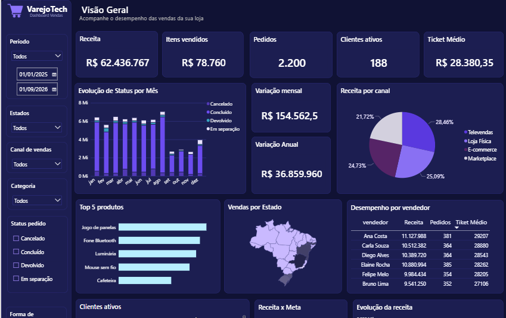
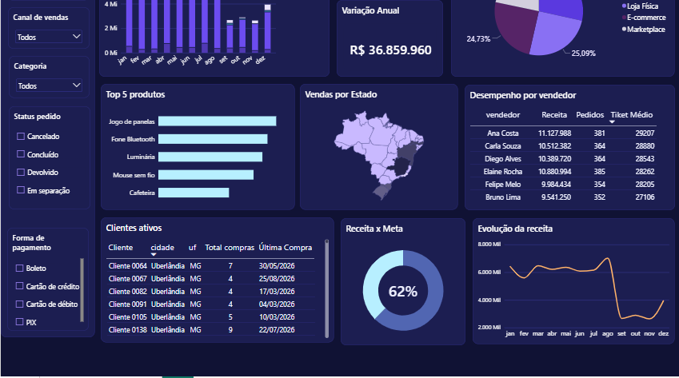
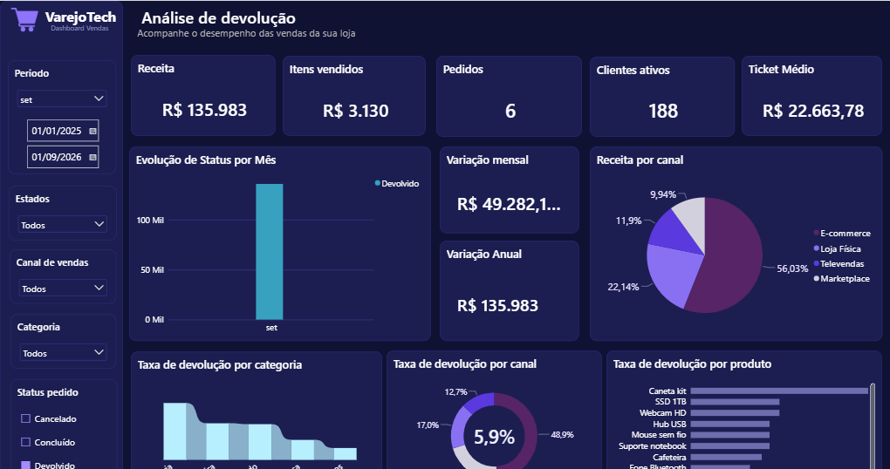
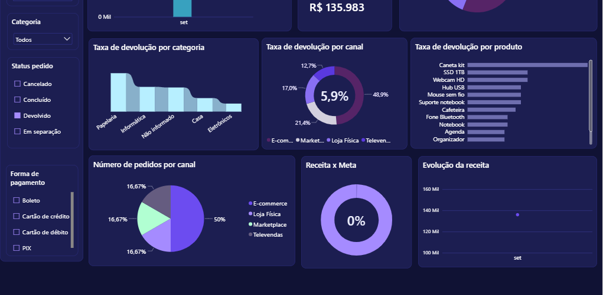

# Análise de Varejo — VarejoTech

Projeto de análise de dados desenvolvido para simular um cenário de análise de vendas no varejo, desde a preparação dos dados até a construção de indicadores e visualizações.

## Objetivo

Analisar o desempenho das vendas, os pedidos, os canais de venda, as categorias e as devoluções, identificando padrões e oportunidades de melhoria.

## Ferramentas utilizadas

- **SQL / MySQL:** criação de tabelas, importação e análise dos dados.
- **Python:** tratamento e análise de dados com Pandas e NumPy.
- **Power BI:** construção de dashboard e indicadores de desempenho.
- **Excel / CSV:** armazenamento e preparação dos dados.

## Dashboard Power BI

O dashboard permite analisar o desempenho das vendas, os pedidos e as devoluções por período, categoria, produto e canal de venda.

## Dashboard Power BI

O dashboard permite analisar o desempenho das vendas, os pedidos e as devoluções por período, categoria, produto e canal de venda.

### Visão geral do dashboard

### Análise de devoluções

### Relatório executivo

O relatório reúne os principais achados da análise e as recomendações operacionais.

[Visualizar relatório executivo em PDF](Relatorio%20executivo.pdf)

O relatório reúne os principais achados da análise e as recomendações operacionais.

## Estrutura do projeto

- `SQL/`: scripts de criação, importação e análise.
- `data/`: base original.
- `notebooks/`: tratamento e exploração dos dados.
- `processed/`: arquivos tratados.
- `powerbi/`: dashboard do Power BI.
- `docs/`: imagens e registros visuais do dashboard.

## Principais análises

- Desempenho das vendas e dos pedidos.
- Receita por canal e categoria.
- Cancelamentos e devoluções.
- Produtos com maior contribuição para o lucro.
- Tratamento e validação da qualidade dos dados.

Projeto desenvolvido para fins de aprendizado e portfólio profissional.